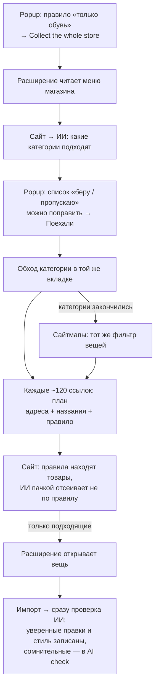

# ИИ — мозг сбора: «только обувь», весь сайт, чистые карточки

Статус: черновик (2026-10-17)

## Зачем

Кнопка «Collect the whole store» обходит магазин целиком, но собирает всё
подряд. Администратору нужно сказать словами, что брать («только мужская и
женская обувь»), и чтобы расширение открывало только это. Остальное оно
должно пропускать, не тратя на него время (около 2–5 с на вещь). Каждая
собранная вещь должна сразу приходить чистой: фото, цвет, описание, название,
бренд, категория, пол и стиль. Тогда агенту в админке не придётся доводить
каждую карточку руками.

Что есть сейчас:
- **Выбор категорий по правилу** (расширение 1.2.0) готов, но его часть для
  сайта на `goo-fashion` не выкачена. На живом сайте ИИ в расширении сейчас
  не работает.
- **ИИ выбирает только категории.** «New in» и «Sale» при правиле «только
  обувь» остаются и тянут всё подряд.
- **Агент AI check** правит бренд, название, категорию, подкатегорию, пол,
  цвет, материал, размеры и описание. По умолчанию он только предлагает, и
  правки ждут человека. **Стиль он не ставит**: стиль выбирается по словарю
  слов.

## Решения

1. Как ИИ отсекает лишнее → **категории плюс проверка каждой вещи по названию
   и адресу до открытия.** Лишнее не открывается вообще.
2. Сайтмапы при правиле → **читаются, но через тот же фильтр вещей.** Так
   «весь сайт» действительно весь.
3. Кто доводит поля → **ИИ проверяет каждую вещь сразу при импорте и сам
   записывает уверенные правки, включая стиль.** Сомнительные правки остаются
   на проверку в AI check.
4. Предпросмотр → **в popup список категорий «беру / пропускаю»**, галочки
   можно поменять, потом кнопка «Поехали».
5. Как попадает на сайт → **PR прямо в `Darakhamia/goo-fashion`.**
6. Бюджет → **общий месячный лимит AI check.** Сейчас он $5, поднять можно в
   Goo Studio → AI check, максимум $100.

## Что входит / что не входит

**Входит — сайт (PR в `goo-fashion`):**
- выбор категорий по правилу — серверная часть 1.2.0, которой на сайте ещё
  нет;
- **отбор вещей по правилу**: план получает адреса и названия вещей, ИИ
  пачками примерно по 100 отвечает «брать / не брать». Если ИИ сомневается,
  вещь берётся;
- **проверка каждой вещи из расширения сразу после импорта**: уверенные
  правки (high) записываются, даже если AI check в общем режиме
  «предлагать». Это относится только к вещам, пришедшим из расширения;
- **стиль**: новое поле у агента — один или несколько из 5 стилей каталога
  (casual, minimal, classic, streetwear, sporty). Записывается тоже только
  уверенный стиль;
- расходы сбора (отбор и проверка) учитываются в общем месячном лимите AI
  check и видны на его экране;
- папка `extension/` в `goo-fashion` обновляется до новой версии (сейчас там
  1.0.12), чтобы расширение ставилось из основного репозитория.

**Входит — расширение (новая версия 1.4.0):**
- название каждой вещи берётся с карточки каталога (текст ссылки или
  карточки), а для сайтмапа — из `image:title` или из адреса;
- предпросмотр выбора категорий в popup: список, галочки, «Поехали»; Resume
  не спрашивает заново;
- в popup видно, сколько вещей ИИ пропустил;
- при правиле сайтмапы снова читаются, через фильтр вещей.

**Входит — проверка:** тесты на сервере и в расширении, сквозные прогоны в
Chromium, `tsc` и ESLint на сайте, README.

**Не входит:**
- проверка по самой странице вещи после открытия (вариант 1в) — она не
  выбрана;
- сбор быстрее темпа 1.3.0, параллельные вкладки — это риск бана;
- отдельный экран правил в админке — правило пишется в popup;
- переделка AI check (режимы, экран). Меняется только одно: добавляется поле
  «стиль», и для вещей из расширения уверенные правки записываются сразу.

## Как будет устроено

- **Где живёт ИИ.** Только на сайте, с ключом и моделью AI check. Ключ в
  расширение не попадает. Расширение спрашивает через вкладку Collect, как
  сейчас.
- **Отбор вещей.** Запрос плана получает поле `pieces: [{url, name}]` и
  правило. Сервер сначала, как сейчас, правилами решает, что из ссылок —
  товар. Потом спрашивает ИИ про эти товары: одна пачка — до 100 названий,
  пачки идут параллельно, чтобы уложиться в 60 секунд Vercel. Ответ
  расширению — только подходящие адреса и число пропущенных.
- **Проверка при импорте.** После записи вещи сайт ставит её в проверку AI
  check с пометкой «из расширения». Для таких вещей уверенные правки
  записываются сразу. Это происходит в фоне (`after()`), поэтому сбор не
  ждёт.
- **Стиль.** Агент получает список из 5 стилей каталога и их смысл. Если
  пишет стиль, только из этого списка. Уверенный стиль заменяет стиль из
  словаря, сомнительный — предлагается.
- **Лимит.** Всё учитывается как расходы AI check. Когда месячный лимит
  исчерпан, прогон не останавливается: отбор вещей выключается (берутся все
  вещи из выбранных категорий), проверка при импорте откладывается в
  фоновую очередь AI check до нового месяца или до поднятия лимита. Popup
  предупреждает об этом жёлтой плашкой.
- **Предпросмотр.** Прогон останавливается на шаге «жду подтверждения» и
  хранит список в расширении. Если закрыть popup, при следующем открытии
  список снова там. «Поехали» отправляет выбранные галочки.

**Сколько стоит (gpt-4o-mini, модель по умолчанию в AI check):**
- выбор категорий — доли цента на прогон;
- отбор вещей — около $3 на 600 000 вещей;
- проверка при импорте — около $0,13 на 1 000 вещей, то есть около $80 на
  600 000.

## Риски и допущения

- **Лимит $5 мал.** Его хватит примерно на 35 000 проверенных вещей в месяц.
  Для большого магазина лимит надо поднять в AI check: максимум $100, этого
  хватит на ~750 000 вещей.
- **Названия без слова «обувь»** («Samba OG», «550») ИИ может не узнать.
  Правило «сомнительное — берём» лучше лишнего, чем потерянного; агент
  поправит категорию.
- **Карточка без текста** (только картинка). Тогда ИИ решает по адресу, а
  если и адрес ничего не говорит — вещь берётся.
- **PR в `goo-fashion` должен влить владелец** (`Darakhamia`). Пока он не
  влит, расширение 1.4.0 работает, как 1.3.0, и пишет, что сайту нужно
  обновление.
- **Миграция 025** (таблицы AI check) должна быть на базе. Без неё
  проверка при импорте не пишет и говорит об этом; сбор не страдает.
- **В контейнере нет ключа OpenAI.** Живые ответы ИИ проверяются только на
  вашем сайте. В тестах модель подменена, весь код вокруг неё настоящий.

## Готово, когда

- В popup пишу «только мужская и женская обувь», жму «Collect the whole
  store» и вижу список категорий с отметками «беру / пропускаю». Могу
  поправить галочки и нажать «Поехали».
- Во время прогона popup показывает «ИИ пропустил N вещей». Вещей не по
  правилу нет в журнале запросов к магазину: они не открывались.
- Сайтмапы читаются, и из них приходят только вещи по правилу.
- У каждой вещи из расширения через несколько секунд после импорта уже
  проверены ИИ бренд, название, цвет, описание, категория, пол и стиль.
  Уверенные правки записаны, сомнительные видны на экране AI check.
- Расходы сбора видны на экране AI check. Когда лимит исчерпан, прогон идёт
  дальше без ИИ, и popup об этом предупреждает.
- Нет ключа или ИИ ошибся — прогон идёт без отбора, с предупреждением.
- PR в `goo-fashion` открыт, `tsc` и ESLint чистые, тесты и сквозные
  прогоны зелёные.
